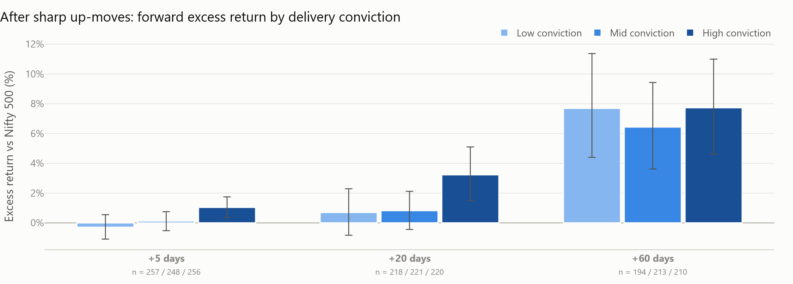
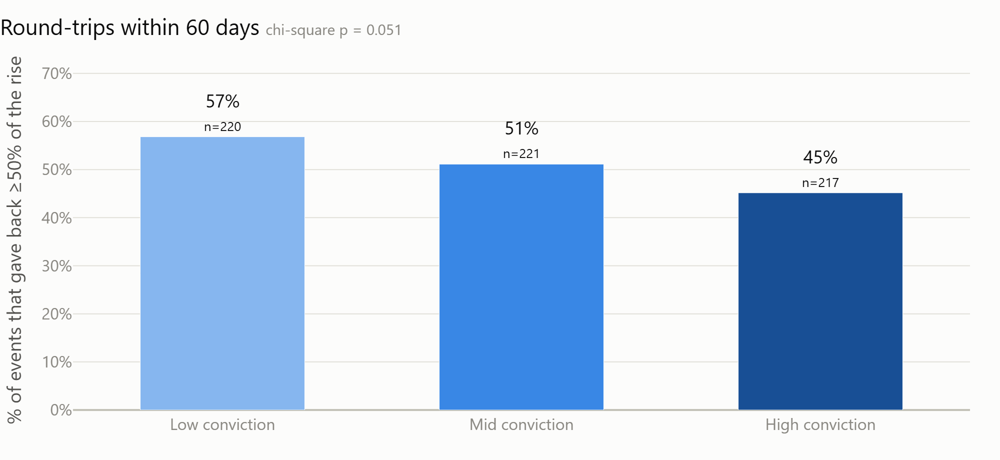

# Delivery-Based Movement Analysis on NSE

> ⚠️ **Research / education tool. Not investment advice.** One year of data is a pilot study: results are indicative, not proof.

NSE publishes, for every stock and every day, the **delivery %**: shares actually delivered into buyers' demat
accounts ÷ shares traded. A price rise on 15% delivery is mostly same-day speculation; a rise on 60% delivery means
buyers are taking the shares home.

**Question:** do sharp price moves backed by abnormally high delivery hold their gains better over the next 1–3
months than moves on low delivery?

This repo contains (1) a reproducible 1-year historical study that answers the question with statistics, and
(2) a live Streamlit dashboard that refreshes every trading evening with a **Conviction Score** for every stock.

---

## Pilot result (data 28 Jul 2025 → 25 Sep 2026, 495 Nifty 500 stocks)

656 sharp up-moves (≥ 20% in ≤ 20 trading days) split into Low / Mid / High conviction terciles by delivery during
the move relative to the stock's own 60-day normal. Excess return is measured against the Nifty 500 index.

| High − Low excess return | +5 days | +20 days | +60 days |
|---|---|---|---|
| Difference | **+1.3 pp** | **+2.3 pp** | +3.3 pp |
| Welch p | 0.020 ✔ | 0.029 ✔ | 0.117 |
| n (High / Low) | 217 / 214 | 213 / 208 | 174 / 181 |

* Round-trips (gave back ≥ 50% of the rise within 60 days): **High 49% vs Low 59%** (chi-square p = 0.13).
* Robustness: across 15/20/25% moves × 10/20/30-day windows, High beat Low in **9 of 9** settings (1 significant at 5% on the 60-day horizon).
* Down-moves (secondary): no difference (p = 0.89).

**Plain English:** yes in the short term; over 3 months high-delivery rallies did better on average, but that gap
could still be chance with one year of data. Full write-up: [reports/summary.md](reports/summary.md) (regenerated on every update).




---

## Setup

Python 3.10+ (tested on 3.12, Windows 11). Run on a **home/college connection**: NSE blocks most cloud servers.

```bash
pip install -r requirements.txt
```

PNG export uses `kaleido`, which drives a locally installed Chrome/Edge. If none is found, `report.py` writes
interactive HTML instead of PNG.

## Run it (one command per stage)

```bash
python -m src.download --months 14 --source nse     # ~10 min first time, cached afterwards
python -m src.clean && python -m src.features && python -m src.events && python -m src.stats && python -m src.score && python -m src.report
streamlit run app/streamlit_app.py
python -m pytest                                     # 17 unit tests
```

Every stage prints a short data-quality check; `clean` writes `data/logs/data_quality_clean.txt`, `events` prints
10 random events to spot-check against a chart on nseindia.com.

If NSE refuses downloads, use the GitHub mirror (covers up to ~Dec 2025 only):
`python -m src.download --source github --start 2024-10-01 --end 2025-12-31`

## Live daily update

```bash
python -m src.update_daily            # download missing days -> rebuild -> log (safe to re-run)
python -m src.update_daily --push     # also git commit + push data for a cloud-hosted dashboard
python -m src.update_daily --loop     # keep running; fires Mon–Fri 19:30 IST (uses `schedule`)
```

* Exits cleanly with a message if today's file is not published yet (NSE posts ~6–7 PM IST).
* Every run is logged to `data/logs/run_history.csv`.
* The whole derived dataset is rebuilt (≈ 2 min) rather than patched: a split on the new day back-adjusts that
  stock's entire history, so recomputing is simpler and always correct.

**Scheduler**
* Windows: run `scripts\schedule_daily.bat` once. It registers the Task Scheduler job "NSE Delivery Update",
  Mon–Fri 19:30, which calls `scripts\run_daily.bat`. Remove with `schtasks /Delete /TN "NSE Delivery Update" /F`.
* Linux/macOS: `sh scripts/schedule_daily.sh` installs the cron line `30 19 * * 1-5` with `CRON_TZ=Asia/Kolkata`.

**Optional cloud dashboard:** push the repo to GitHub and deploy `app/streamlit_app.py` on Streamlit Community
Cloud. NSE usually blocks cloud IPs, so keep the update job on the laptop with `--push`; the cloud app reads the
committed Parquet files (`data/raw/` is git-ignored; `data/clean`, `data/derived` and `reports` are committed).

## Dashboard pages

1. **Overview**: data date, stocks tracked, headline result card, how to read the score, disclaimer.
2. **Stock Explorer**: search a symbol → price (candles), delivery % bars with the 60-day baseline, Conviction
   Score gauge, past events marked and shaded on the chart, event table.
3. **Today's Leaderboard**: top 20 High (score ≥ 70) and Low (score < 30) stocks, filter by 20-day price change
   ("Up > 10% on low conviction" = watch list), CSV download.
4. **Historical Analysis**: tercile excess returns with 95% CI and n, round-trip rates, High-vs-Low tests per
   horizon, robustness grid, sortable table of every event; up-moves and down-moves.
5. **Demo: Guess the Stock**: a random matched pair (one High, one Low tercile, similar move size, completed
   events only); visitors guess which held up, then the names, delivery and outcome are revealed.

## Method

| Step | Definition (all thresholds in `config.yaml`) |
|---|---|
| Data | `sec_bhavdata_full_DDMMYYYY.csv` (full bhavcopy + delivery), Nifty 500 close from `ind_close_all_DDMMYYYY.csv` |
| Universe | Today's Nifty 500 list; ≥ 200 trading days and median turnover ≥ ₹1 crore |
| Series | Delivery from `EQ` rows only (BE/T2T are delivery-only by rule → fake 100%). BE/BZ days are kept for **price continuity only** |
| `deliv_pct` | DELIV_QTY / TTL_TRD_QNTY × 100 |
| `baseline_60` | median `deliv_pct` of the previous 60 trading days (shifted 1 day, min 40) |
| `rel_deliv` | `deliv_pct − baseline_60`; `deliv_qty_ratio` = DELIV_QTY / previous-60-day median |
| Event | close ≥ 20% above the **most recent** lowest close of the prior 20 days; 40-day cool-down per stock & direction; event dates inside the last 12 months |
| Event delivery | Σ DELIV_QTY / Σ TTL_TRD_QNTY from trough+1 to event day; `event_rel_deliv` = that − baseline on the trough day |
| Groups | terciles of `event_rel_deliv` (Low / Mid / High) |
| Outcomes | returns +5/+20/+60 days, excess vs Nifty 500; round-trip = gave back ≥ 50% within 60 days; max drawdown within 60 days; horizons past the last date are NaN and the event is marked `incomplete` |
| Stats | Welch t-test, bootstrap 95% CI (10,000 resamples), chi-square on round-trips, groups with n < 30 flagged "insufficient data" |
| Conviction Score | percentile (0–100) of the 5-day mean `rel_deliv` within the stock's own last 250 days (min 60); bands 0–30 Low, 30–70 Neutral, 70–100 High |

No look-ahead: every baseline, score and event on day *t* uses data up to *t* only (unit-tested by appending
future rows and checking nothing earlier changes).

### Data issues found and handled

The build uncovered four quirks beyond the known ones (leading spaces, `-` values, HTML holiday pages):

1. **PREV_CLOSE is *not* split-adjusted** in `sec_bhavdata_full` on ex-dates (e.g. Adani Power 1:5 split on
   22-Sep-2025: PREV_CLOSE 709.40, open 148.20). The PREV_CLOSE rule alone found 0 of 24 corporate actions.
   `clean.py` therefore also flags an **opening gap** (< 0.72× or > 1.5× the previous close) that lies within a few %
   of a standard split/bonus ratio (1/2, 1/3, 1/5, 1/10, 2/5, 2/3, …) and snaps to that ratio; gaps beyond 0.5×/2×
   that match no ratio (demergers such as Vedanta, 30-Apr-2026) use the actual ratio. All 24 are logged in
   `data/logs/corporate_actions.csv` with the method used. The only remaining > 30% daily move is a genuine
   intraday crash (PolicyBazaar, 24-Sep-2026).
2. **NSE serves the previous day's file on some holidays** (HTTP 200, valid header, e.g. 1-May-2026 contained
   30-Apr data). The downloader checks the date *inside* the file and removes stale copies (13 found).
3. **Weekend special sessions** (Union Budget, Sunday 1-Feb-2026) are not weekdays; they are listed in
   `download.extra_dates`. As a safety net, if > 5% of stocks "split" on the same day, `clean.py` treats it as a
   missing session, adjusts nothing and warns.
4. **Series hops** (EQ → BE → EQ) would create fake price jumps if BE days were dropped; they are kept for price only.

## Repository

```
config.yaml            thresholds, paths, source
src/download.py        fetch + validate + cache (--start --end --months --source)
src/clean.py           parse, strip, corporate actions, universe → data/clean/panel.parquet
src/features.py        deliv_pct, baselines, rel_deliv → data/derived/features.parquet
src/events.py          event detection, scoring, outcomes → data/derived/events.parquet
src/stats.py           tests, bootstrap, robustness → data/derived/stats.json, robustness.parquet
src/score.py           daily Conviction Score → data/derived/scores.parquet
src/report.py          reports/charts/*.png + reports/summary.md
src/charts.py          Plotly figures shared by report and dashboard
src/update_daily.py    incremental update + optional scheduler loop / git push
app/streamlit_app.py   dashboard
tests/                 pytest unit tests
scripts/               Windows Task Scheduler + cron helpers
```

## Booth demo (5 lines)

See [reports/demo_script.md](reports/demo_script.md).

## Limitations

* **1 year is a pilot:** a few hundred events, one market regime; results are indicative, not proof.
* Delivery shows that shares were **taken, not who took them or why**: block deals, promoter buying and index
  rebalancing can inflate it.
* Terciles are formed using the whole year's events: fine for describing the past, not a tradable rule.
* The universe is **today's** Nifty 500 list (survivorship bias); ticker renames are not linked.
* Corporate-action detection is heuristic (see above). Dividends are not adjusted.
* No transaction costs, slippage or taxes; **this is not a trading strategy.**

## Trading terminal (main UI)

```bash
python -m app.server        # opens http://localhost:8000 in your browser
```

A light, TradingView-style terminal built on TradingView's open-source Lightweight Charts
(bundled in `app/static/vendor`, so it works offline):

* **Watchlist**: High / Low conviction, "Rising · low" (up 10%+ in 20 days on low delivery), All.
* **Chart**: candles with sharp-rise markers; delivery % bars (dark blue = 10+ pts above normal,
  light blue = above, grey = below), 10-day smoothed delivery and the 60-day normal.
  Daily / weekly candles, 1M–All ranges, SMA 20/50, trend line, horizontal line, measure, screenshot.
* **Buyer zones** (shaded): blue = the 10-day smoothed delivery has risen 5+ pts above the stock's
  normal (buyers taking and holding shares) and stays until it falls back under +2 pts; orange = the
  mirror image (mostly same-day trading). Trailing data only; descriptive, not backtested.
* **Right panel**: the Conviction Score and the four steps behind it for the selected stock, its
  past sharp rises with 60-day outcomes, and the backtest evidence.

The older Streamlit dashboard (`streamlit run app/streamlit_app.py`) is kept as a backup.

### Website and terminal features (latest)

* `/` landing page, `/terminal` trading terminal, `/about` team page. Start with `python -m app.server`.
* Light and dark themes (button or `T`), Inter + JetBrains Mono fonts bundled offline.
* Watchlist with 20-day sparklines, shaded score pills and a dot for stocks in a buyer zone; NIFTY 500 strip in the top bar.
* Score gauge, step-by-step method, buyer zone, past rises and backtest in collapsible panels.
* Keyboard: `/` search, `↑↓` stocks, `D`/`W` interval, `1`–`5` range, `T` theme, `A` assistant, `F` fullscreen, `?` help.
  The URL keeps the stock, interval and range (e.g. `/terminal#CGCL?i=W&r=12`).
* **Lens Assistant** (`A`): answers plain-English questions ("summarize TCS", "why this score?", "compare TCS vs INFY",
  "rising on low delivery", "does this method work?") from the project's own data. Rule-based, no external AI
  service, so every number it gives is real (`app/assistant.py`).

## IMPI extension (F&O research system + institutional pages)

The `impi/` folder holds IMPI (Indian Market Positioning Intelligence), the follow-up research system:
2014–2026 official NSE data, a pre-registered study with a test set evaluated once, and model v2 with a
live forward track record. See `impi/README.md`, `impi/results/summary.md` and `impi/decisions.md`.

The same server now also serves:

| Page | What it shows |
|---|---|
| `/terminal` | new **IMPI model** panel for F&O stocks (probabilities vs base rates, percentile, delivery/compression/positioning snapshot, top drivers) and IMPI breakout markers (toggle "IMPI") |
| `/scanner` | every F&O stock today, sortable; filter compression / VCP / 20-day breakouts and sector |
| `/market` | FII / DII / Pro / Client futures positioning (net-long share and 52-week range), Nifty 500, India VIX, regime tiles |
| `/research` | pre-registered results, v2 model quality (CV and post-hoc), live track record, figures |

The Ask Lens assistant also answers "IMPI model view", "Today's breakouts", "Market positioning" and
"Does the IMPI model work?". `scripts/run_daily.bat` runs the IMPI live update right after the Delivery Lens
update every weekday evening (about 10–25 minutes). Pages read files exported by `python -m impi.live`;
until that has run they show a clear "not built yet" message.
